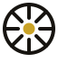

<h1> DavFXStudio</h1>

     

> **Portfolio:** Explore the work and contact details at [guns.lol/davfxstudio](https://guns.lol/davfxstudio).

**DavFXStudio is my creative portfolio for design, photography, and digital media work.**

The site is built with plain HTML, CSS, and JavaScript, with no build step. Each project is stored as an entry in `content.js`, so the portfolio can be updated by editing one structured file and adding images to `assets/`.

## Run Locally

Requires Node.js 20+

```
npm start
```

Open `http://127.0.0.1:4173/portfolio/`

## Update

Edit `content.js` — each project is an entry in the `projects` array (title, discipline, medium, image, description). Images go in `assets/`.
